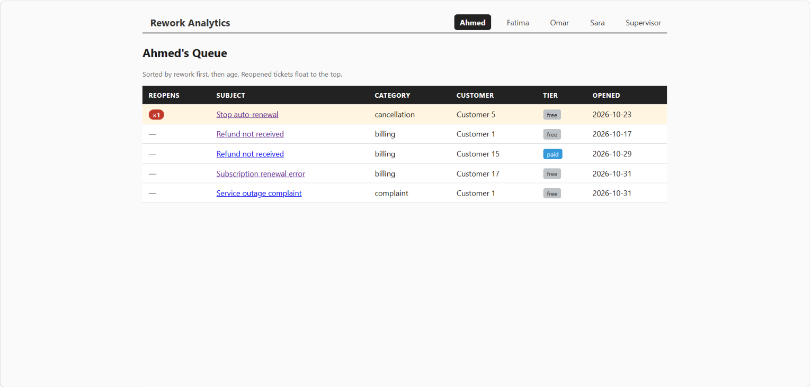
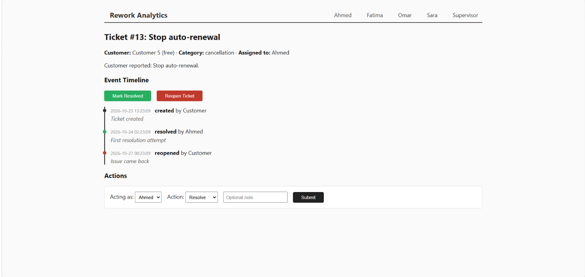

# Resolution Analytics (Rework-First Ticketing)

A portfolio-scale ticketing system designed to be a module within a larger call-center CRM.

## The Problem

In standard ticketing systems, tickets are sorted by time (for example, oldest first or SLA countdown). A ticket that has been "resolved" three times and failed three times looks identical to a fresh ticket that just arrived.

This system is built on a different premise: **rework is the most critical metric.** A ticket that has been reopened is a categorically different problem than a new one. It means the first fix failed. The agent queue in this app sorts by **rework (highest first), then age**, so agents are not blindly stepping on the same landmines.

## Core Design Decisions

### 1. Status Is Derived, Not Stored

The `tickets` table has no `status` column and no `reopen_count` column.

Instead, the system uses an append-only `ticket_events` log. Every action (create, assign, resolve, reopen) is a new row in this log. The queue view and dashboard derive the current status and reopen count by querying the log.

**Why?** It prevents status drift. If an agent reopens a ticket, the event is recorded permanently, and rework cannot be silently lost by a buggy database update. The full history of who tried to fix the issue and failed is preserved and visible to the next agent.

### 2. Two Distinct Views

- **Agent Queue:** Sorted by rework. Tickets reopened 2+ times float to the top with a red badge, so agents can prioritize high-friction cases.
- **Supervisor Dashboard:** Surfaces system-wide failure points, including Rework Rate per Agent, Rework Rate per Category, and a Critical Rework watchlist for tickets that have failed 2+ times and are still open.

### 3. No "Create Ticket" Form

In a real call center, tickets are ingested through phone systems, email parsers, or chat widgets, not typed in manually by agents. To simulate a production environment, this app uses `seed.py` to generate historical rework data. This keeps the focus of the application on the **agent and supervisor experience** of handling the queue.

## Tech Stack

- **Backend:** Python 3.10+, FastAPI, Uvicorn
- **Database:** SQLite (via native `sqlite3`)
- **Frontend:** Jinja2 templates, vanilla CSS, Chart.js (for dashboard visualization)

## Screenshots

**Agent Queue (sorted by rework)**



**Supervisor Dashboard (rework rate visualization)**


**Ticket Event Timeline (immutable audit log)**



## Local Setup

Follow these steps to run the application on your local machine.

### 1. Clone the repository

```bash
git clone https://github.com/YOUR-USERNAME/rework-analytics.git
cd rework-analytics
```

### 2. Create and activate a virtual environment

Running the app in a virtual environment is recommended to avoid dependency conflicts.

**Windows:**

```bash
python -m venv venv
venv\Scripts\activate
```

**macOS/Linux:**

```bash
python3 -m venv venv
source venv/bin/activate
```

### 3. Install dependencies

```bash
pip install -r requirements.txt
```

If the file is missing, install the packages manually:

```bash
pip install fastapi uvicorn jinja2
```

### 4. Generate the mock database

The app needs a local SQLite database to run. This script creates the schema and populates it with realistic historical data: 20 customers, 4 agents, and 30 tickets with mixed rework histories.

```bash
python seed.py
```

You should see this output:

```
Seeded: 20 customers, 4 agents, 30 tickets with rework history.
```

### 5. Start the application server

```bash
uvicorn main:app --reload
```

### 6. Open the web app

Open your browser and go to:

```
http://127.0.0.1:8000
```

The root URL (`/`) automatically redirects to Agent 1's queue.

## Troubleshooting and Known Limitations

- **`ModuleNotFoundError`:** Make sure your virtual environment is activated (step 2) before running `uvicorn` or `python seed.py`.
- **`sqlite3.OperationalError: no such table`:** You most likely started the server before running the seed script. Stop the server (`Ctrl+C`), run `python seed.py`, and restart.
- **Resetting the database:** To wipe the data and start fresh, delete the `ticketing.db` file and run `python seed.py` again.
- **Authentication:** The app currently uses a simple dropdown to simulate being logged in as a specific agent. A production version would need proper authentication, such as JWT.
